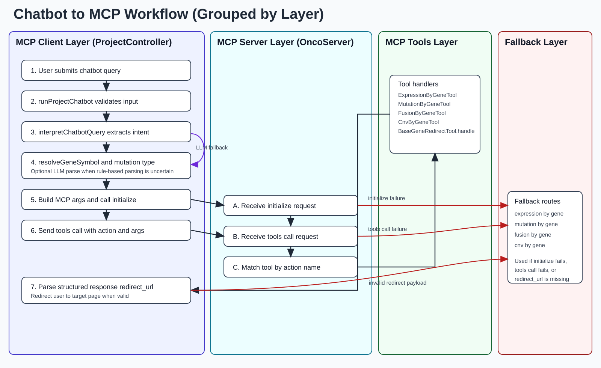
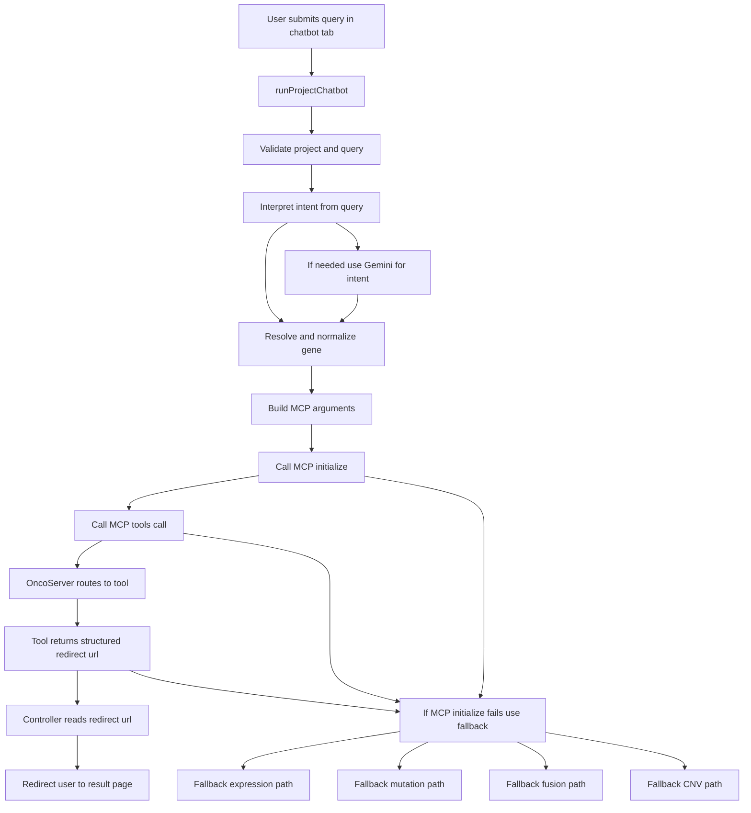

# Chatbot to MCP Workflow

This document describes how a user query is interpreted and routed through the project chatbot, MCP server, and tool handlers.

## End-to-End Flow

SVG version: [chatbot-mcp-flow.svg](chatbot-mcp-flow.svg)





## Notes

- MCP invocation is attempted first for supported actions.
- Legacy fallback behavior is preserved if MCP initialize/tool call fails.
- Gene symbol correction uses exact match first, then fuzzy matching.
- Gemini parsing is used only when rule-based intent extraction does not match.

## Compact MCP responses

External MCP clients can opt into `output` on tabular tools: project and
cancer-type resolvers; cohort samples, ChIP-seq, expression and mutation genes;
project patients, cases, sample/case joins, CNV, HLA, STR, QC and pathogenic
mutations; fusion calls and diagnosis fusion details; both correlation tools;
cross-cohort expression summaries; and sample-level mutation details. Tools are registered through MCP auto-discovery.

Resolve a project without retrieving the whole catalog:

```json
{"query":"COMPASS","match":"exact","output":{"mode":"compact","fields":["Project ID","Project Name"]}}
```

Pass these arguments to `getProjects`. `query` is case-insensitive; `match`
defaults to `contains`. Exact matching retains all ambiguous matches. Only
projects visible to the authenticated user are searched.

For a page of samples, call `getCohortSamples` with:

```json
{"cohort_type":"project","cohort_id":25062,"exp_type":"RNAseq","output":{"mode":"compact","limit":100,"offset":0}}
```

Compact responses return `columns`, `rows`, `total_rows`, `returned_rows`, and
`next_offset`. Use the returned offset with identical filters for the next page.
The default limit is 100, maximum 1000. `fields` selects exact titles from
`columns`; unknown fields return an error. Pagination operates on the current
filtered result, not a stored snapshot.

Use `output: {"mode":"summary"}` for full filtered counts and existing statistics
without rows. `total_rows` counts table rows, not unique patients; use named
patient/sample/gene counts where present. Expression statistics remain based on
all filtered samples. Tiered mutation counts must not be summed as unique patients.

Omitting `output` preserves the legacy payload. Compact responses omit duplicate
UI/data representations; plots require legacy output. The website's AI adapter
hides/removes `output`, records the complete UI result, and applies its existing
agent-preview compactor. These options reduce model-facing payloads, not database
query work: authorization, domain queries, and filtering still run first.

Reconnect the MCP client to discover updated schemas and server instructions.
An existing session may retain the old catalog or connection. For verification,
check that `tools/list` includes `getProjects.query` and `output`, then run the
filtered lookup above; expect `output_mode: "compact"`, not the full catalog.

## Expression presentation by interface

The web chatbot opens the project expression viewer for plain "show expression"
requests. Fixed project pages can do this immediately. Global/home chat applies
the same rule after successful expression tools identify one authorized project,
including a project-selection reply to a clarification. It stores the viewer URL
and project context with the conversation so reloading preserves the result.
Failed, diagnosis-scoped, and multi-project results do not trigger this redirect.
Explicit table, summary, statistics, comparison, export, and non-heatmap plot
requests continue through the data/chart path.

This policy lives in the web controllers. External MCP clients still receive
expression data and compact tables/statistics; they are not redirected by this
web-only presentation step.


## Wiki tutorial answers

`searchOncogenomicsWiki(query, limit=5)` searches a local snapshot of the public
[Oncogenomics wiki](https://github.com/CCRGeneticsBranch/Oncogenomics_v2/wiki).
It is available in global, project, and cancer-type scopes, requires no cohort,
and returns up to eight relevant passages with page/section URLs and the wiki
revision/index timestamp. The chatbot cites those sources for tutorial answers;
actual patient/project results still come from authorized data tools. Screenshot
links are preserved as references; the search does not interpret image pixels.
For tier questions, the tool also returns the relevant germline, somatic, or
fusion tier figures with local image URLs and wiki citations. The chatbot can
embed them in its Markdown answer. The renderer permits only these three known
figures, serves them from the application's existing tutorial assets, and makes
them clickable for full-size viewing; other Markdown images remain blocked.
Tutorial questions bypass automatic viewer redirects.

The bundled snapshot is `resources/knowledge/oncogenomics-wiki.json`. Refresh the
runtime snapshot manually after editing the wiki:

```sh
php artisan chatbot:refresh-wiki
```

When editing the separate wiki checkout under `docs/wiki`, include those edits
by using `php artisan chatbot:refresh-wiki --source=docs/wiki`. That checkout is
ignored by the application repository and has its own Git history. The index
records the base wiki revision, whether the working tree has local changes, and
a content SHA-256. Unpublished edits can be searched locally, but new GitHub page
links will not resolve until the wiki edits are published. Copy a reviewed index
to the bundled snapshot when preparing application deployment artifacts.

This downloads the fixed public wiki Git repository and atomically replaces
`storage/app/knowledge/oncogenomics-wiki.json`. No GitHub token, embedding service,
or network call during a chatbot search is needed. A failed refresh preserves the
previous snapshot; a missing/corrupt runtime snapshot falls back to the bundle.
For an existing local wiki Git checkout, use
`php artisan chatbot:refresh-wiki --source=/path/to/wiki-checkout`.
No recurring refresh job is installed.

## Filtered fusions, multi-gene expression, and variant details

`getFusionCohortDetail` handles both `cohort_type=project` (numeric ID from
`getProjects`) and `cohort_type=cancer_type` (exact value from `getCancerTypes`).
It lists fusion pairs without requiring a gene and accepts optional `gene`,
`partner` (requires gene), `caller`, and `tier` ("1" through "4").
`cutoff` is the inclusive minimum number of distinct patients per pair/tier,
defaults to 2, and can be set to 1 for single-patient events. It is not a row
limit. The threshold appears in the result metadata and summary. Project
cohorts also accept an exact `diagnosis` filter and respect the project's fusion
table setting. Fixed chatbot scopes inject the cohort fields server-side.
The original `getFusionCancerTypeDetail` remains available to external MCP
clients and cancer-type/global chatbots for compatibility; chatbot instructions
prefer the combined tool.
Gene/partner matching accepts either
orientation. Diagnosis matching is exact; it does not expand to subtypes.
Gene/tier/access filters run in SQL before aggregation. Caller names match parsed
caller keys. Counts are distinct patients per pair/tier, not additive totals.

`getCohortExpression` accepts either `gene` or `genes` (1–50 symbols).
For example, after resolving the project ID:

```json
{"cohort_type":"project","cohort_id":24421,"genes":["ALK","FGFR4","MYCN"],"output":{"mode":"compact","limit":100}}
```

The multi-gene path reads expression once, aligns samples, and returns raw TPM
with per-gene statistics over all measured samples. Missing values are null;
measured zero remains zero. Samples without a numeric value for any requested
gene are omitted. Multi-gene plotting/grouping/transforms are not supported by
this path; the existing single-gene plot path remains available.

`getCohortMutationDetails` requires `cohort_type`, `cohort_id`, `gene`, and `type`
(`somatic`, `germline`, `rnaseq`, or `variants`). It returns annotated variant
records with coordinates, consequence, protein change, fractional VAF, coverage,
and germline/somatic tiers. Optional filters: `genome_version` (default hg19),
`sample_id`, `tier`, `tier_context`, and `min_vaf` (0–1).

Unlike the older compact adapters, mutation details paginate in SQL, including
legacy website output. Default page size is 100, maximum 1000. Supply `limit`
and `offset` at top level or under `output`, not both. `total_rows`,
`patient_count`, and `sample_count` describe the full filtered result;
`next_offset` locates the next page. `output.mode=summary` skips row retrieval.
These are annotated records, not necessarily unique genomic variants or
pathogenic calls. Multiple annotation/tier records can describe one variant.
Access is enforced using authorized projects and matching patient/sample pairs.


## Diagnosis filters within project sample lists

`getCohortSamples` accepts `diagnosis` and `diagnosis_match` (`exact`, the default,
or `contains`), applied case-insensitively to diagnosis metadata before counts,
tables, and compact pagination. RMS is accepted as an alias for Rhabdomyosarcoma.
In fixed project chat, keep the project cohort when narrowing by disease. For
"all RMS RNAseq samples", pass `exp_type=RNAseq`, `diagnosis=Rhabdomyosarcoma`,
and `diagnosis_match=contains` to include labeled subtypes. This does not classify
samples from their names or expand other abbreviations. Project sample tables
now include the diagnosis column as evidence for the filter. Assay, library,
and diagnosis filters combine; no matching rows means an empty table.


## Result presentation

Successful tables, charts, images, and links appear in the main answer area.
Compatible `getCohortSamples` tables for the same cohort and identical columns
are combined with duplicate rows removed; diagnosis stays visible in the rows.
Sample tables carry up to 5,000 rows per call to the browser, independently of
the model's compact preview. Larger or already paginated results are explicitly
labeled partial. Other table previews retain their 100-row limit.

Execution arguments, errors, and previews are available under Technical details,
collapsed by default. Existing saved conversations retain their previously stored
row limits; rerun a question to obtain the expanded sample tables.


## Gene queries without a cohort

In the global/home chatbot, a gene query without a project or cancer type runs
across all projects available to the signed-in user. No cohort resolver or
clarification is needed for these tools:

| Tool | Result |
| --- | --- |
| `getExpGeneSummary` | Sample TPM grouped by diagnosis or project |
| `getVarGeneSummary` | Somatic/germline mutation counts or frequencies by tier |
| `getCNVGeneSummary` | Amplified/deleted patient counts or frequencies |
| `getFusionGeneSummary` | Fusion patient counts or frequencies by tier |
| `getFusionGenePairSummary` | Oriented partner-pair patient counts by group |
| `getPatientsByVarGene` | Mutation patient drill-down |
| `getPatientsByCNVGene` | CNV patient drill-down, including event type |
| `getPatientsByFusionGene` | Fusion patient drill-down for either gene side |
| `getPatientsByFusionPair` | Fusion patient drill-down for an exact oriented pair |

Single-gene tools require only `gene_id`. Pair details require `left_gene` and
`right_gene`. Summary `category` defaults to `diagnosis`; `project` changes the
grouping, not the authorization scope. Expression `tissue` defaults to `all`.
Mutation/fusion tiers default to 1 and 2; set `tiers` explicitly to include other
tiers. CNV thresholds are inclusive (default amplification >=3, deletion <=1).
`value_type=count` is the default; `frequency` returns percentages using distinct
authorized patients in each group as the denominator. Partner-pair summaries
return counts only. Patient details default to somatic mutations when relevant.

For patient drill-downs, omit `category` to include every authorized group, or
pass an exact summary label and `cat_type=diagnosis|project`. Project labels are
names from the summary, not guessed IDs. Project names in patient rows include
only authorized memberships. The same protected, bound queries serve the web
page drill-downs. Patient memberships are deduplicated; a patient may still be
in multiple diagnosis groups or both CNV event types. Groups/tiers are not
additive unique-patient totals.

Example `getVarGeneSummary` arguments:

```json
{"gene_id":"ALK","category":"diagnosis","tiers":"Tier 1,Tier 2","output":{"mode":"compact"}}
```

Example `getPatientsByFusionGene` arguments, with no cohort restriction:

```json
{"gene_id":"ALK","tiers":"Tier1,Tier2","output":{"mode":"compact","limit":100}}
```

The new summary tools retain the gene-page chart payload in `data` and also
return a table for website and compact MCP consumers. All nine tools support
compact pagination/field selection and summary mode. Query work runs before
compact pagination. `total_rows` counts summary cells or patient-group rows,
not unique patients. A compact summary reports row counts, not a new sum of
patients across overlapping groups. The scope is explicitly `all_authorized`.

Explicit project/diagnosis requests still use cohort-specific tools. Cross-cohort
gene tools are excluded from fixed project/cancer-type chatbot catalogs and
from global contexts with a server-resolved explicit cohort. Other requests
that require a cohort still follow the resolver/clarification workflow.
Reconnect external MCP clients to refresh the catalog and instructions.


### Current-turn intent routing

Before automatic page redirects, `ClinomicsIntentClassifier` classifies the current
question as `documentation`, `data`, or `mixed`. It receives up to six recent user
and assistant messages (1,500 characters each), with the current question separate.
It has no tools and returns a validated enum, not a rewritten gene/cohort query.
`ChatbotIntent` stores the decision for this request, including provider retries.

Documentation exposes only wiki search. Mixed questions retain wiki and authorized
data tools. Only a data decision permits existing automatic viewer redirects.
If classification fails or returns an invalid enum, the main agent selects tools
with redirects disabled; phrase matching is not used as a fallback. Scope and
cohort authorization checks remain in place. The existing provider/model order is
used with a 20-second per-attempt timeout. SDK usage events include classification
in query logs; this adds one small LLM request before answering. Streaming begins
with an “Understanding the question” status after request validation.

Tests fake classifier decisions to verify routing, history bounds, and failures;
they do not measure a live model's classification accuracy.
